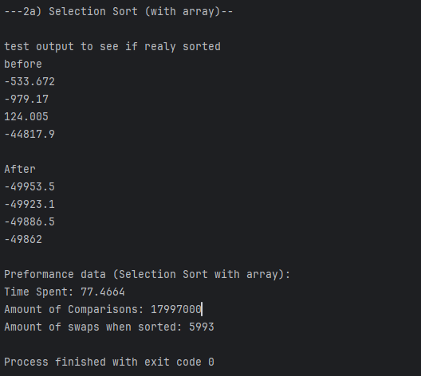
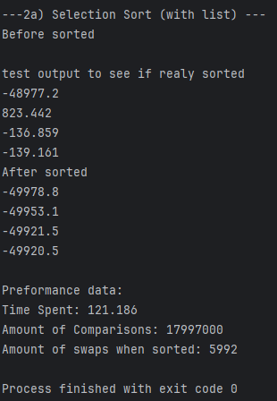
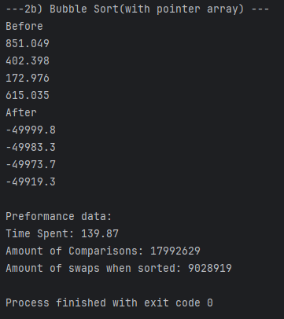
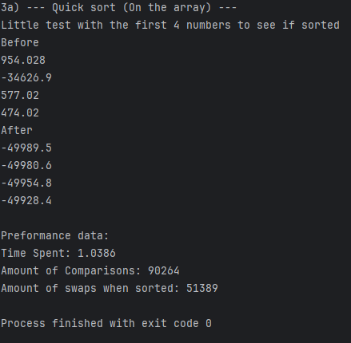
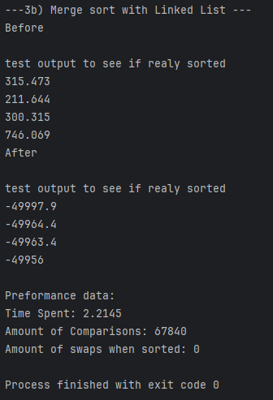
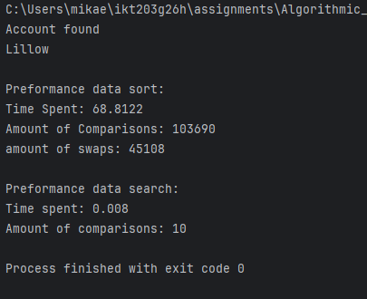

# 4b) Performance Battle: Sorting Algorithms

## 1. Test Setup

- **Datasett:** N = __6000__ accounts (LinkedList genereated by `PopulateAccountsLinkedList`, and then copied to Array by `PopulateAccountsArray`)
- **Comparison function (callback):** `CompareByBalance`
- **Amount of runs per algorithm:** __10__ 
- **Hardware:** Intel Core(TM) Ultra 7 155h & _16GB LPDDR5

## 2. Results Presented in a clear table

| Algorithm      | DataStructure | Comparisons | Swaps     | Time (ms) |
|----------------|---------------|-------------|-----------|-----------|
| Selection Sort | Array         | 17 997 000  | 5991.2    | 79.6531   |
| Selection Sort | Linked List   | 17 997 000  | 5991.1    | 123.9794  |
| Bubble Sort    | Array         | 17 989 425  | 9 046 224 | 142.89    |
| Quick Sort     | Array         | 89 459      | 50 173    | 1.182     |
| Merge Sort     | Linked List   | 67 824      | 0         | 2.489     |

## 3. How do the results illustrate the difference between O(n^2) and O(n log n) complexity? And why was Selection sort harder on a list versus an array?

The results showed in the table above clearly shows the gap between the O(N^2) and O(n log n) algorithms. With N = 6000, the O(N^2) algorithms preforms about 18 000 000 comparisons. And the O(n log n) algorithms preforms far less than that about 80000 avg. The difference in running time follow the same pattern and with larger dataset we would se that this gap in time would increase more because N^2 grows faster than N log(N).

THe reults also showed that complexity is not the only thing that matters. When Selection sort was used on both an array of pointers and a linked list we can se that the time was significaly better when used on an array rather than a linked list. This clearly illustrates the harder work the linked list algortihm had by having to traverse the linked list by the help of pointers.

## 4. Results when comparing Linear Search and Binary Search

Dataset: 6000 accounts | Search key: last name "Lillow" | Comparator: `CompareByLastName`

| Search method | Requires sorted data | Comparisons | Time (ms) | Complexity |
|---------------|----------------------|-------------|-----------|------------|
| Linear Search | No | 2359        | 2.00      | O(n) |
| Binary Search  | Yes | 10          | 0.0082    | O(log n) |

## 4. Appendix

*Picture of one of the selection sort runs*

*Picture of one of the runs with selction sort on a linked list*

*Picture of one of the runs with buble sort on a pointer array*

*Picture of one of the runs with quick sort on a pointer array*

*Picture of one of the runs with merge sort on a linked list*

*Picrure of one of the runs with quick sort + binary search*

*Picture of one of the runs with linear search on a unsorted list*